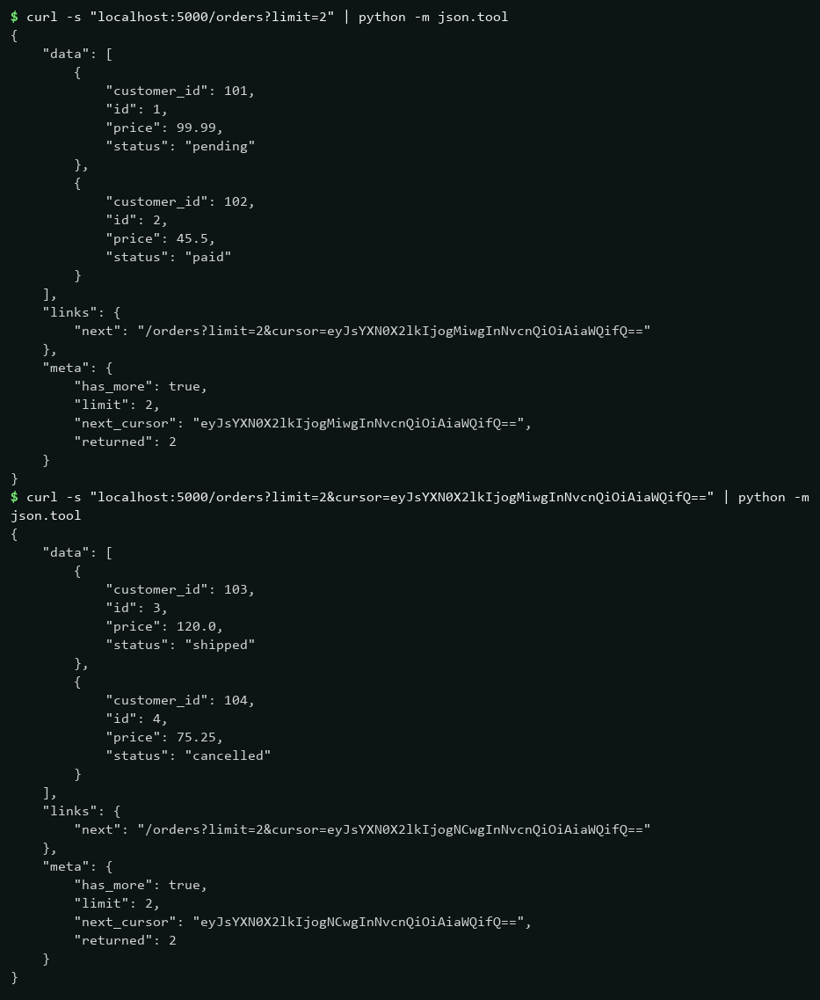
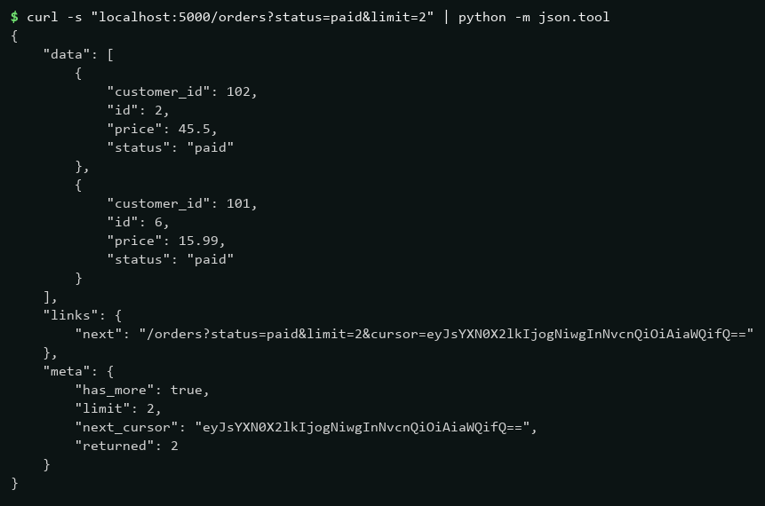
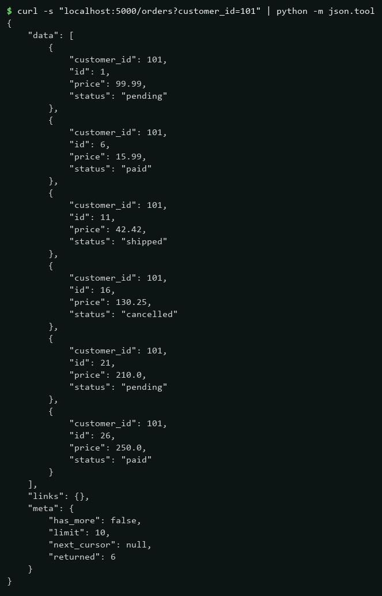
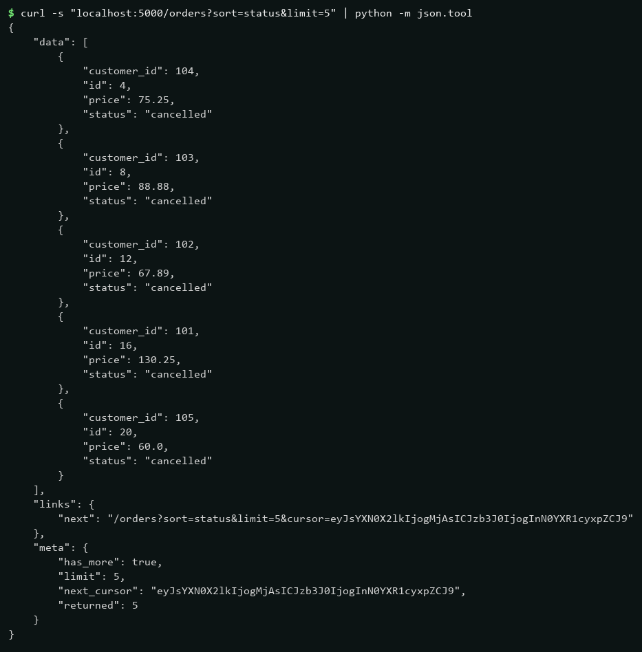
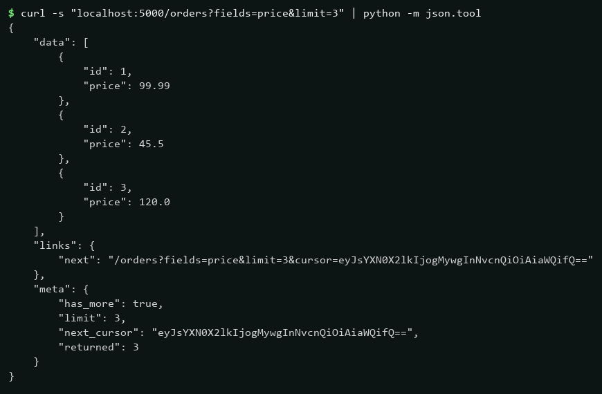

# Week 3 — Lab 3: Cursor Pagination cho Orders API
## 1. Tham số hỗ trợ
| Tham số | Ý nghĩa | Ví dụ |
|---|---|---|
| `limit` | Số bản ghi mỗi trang (1–50, mặc định 10) | `?limit=2` |
| `cursor` | Con trỏ opaque (base64) lấy từ `meta.next_cursor` của trang trước | `?limit=2&cursor=eyJs...` |
| `status` | Lọc theo trạng thái (`pending`, `paid`, `shipped`, `cancelled`) | `?status=paid` |
| `customer_id` | Lọc theo id khách hàng | `?customer_id=101` |
| `sort` | Sắp xếp (`id`, `customer_id`, `status`, `price`; tiền tố `-` là giảm dần) | `?sort=status` |
| `fields` | Sparse fieldsets, chỉ trả về field liệt kê (`id` luôn có) | `?fields=price` |

## 2. Cấu trúc response cursor pagination
```json
{
  "data": [
    {
      "customer_id": 101,
      "id": 1,
      "price": 99.99,
      "status": "pending"
    }
  ],
  "links": {
    "next": "/orders?limit=2&cursor=eyJsYXN0X2lkIjogMiwgInNvcnQiOiAiaWQifQ=="
  },
  "meta": {
    "has_more": true,
    "limit": 2,
    "next_cursor": "eyJsYXN0X2lkIjogMiwgInNvcnQiOiAiaWQifQ==",
    "returned": 2
  }
}
```

## 3. Kết quả kiểm chứng
### Cursor pagination — trang 1 (`limit=2`) rồi dùng `next_cursor` lấy trang 2, không trùng id

### Filter theo `status=paid` — chỉ trả về đơn `paid`

### Filter theo `customer_id=101` — chỉ trả về đơn của khách 101

### Sort theo `status` — đơn xếp theo `status` tăng dần (`cancelled` trước)

### Sparse fieldsets `fields=price` — mỗi item chỉ còn `id` và `price`

