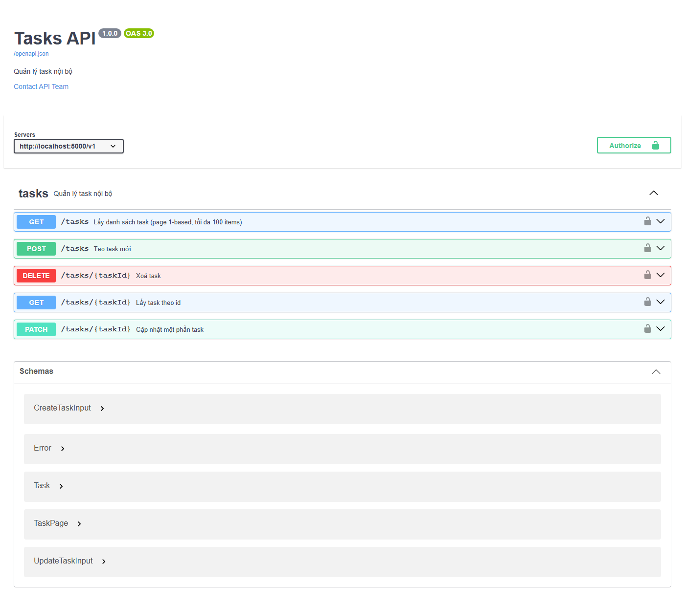
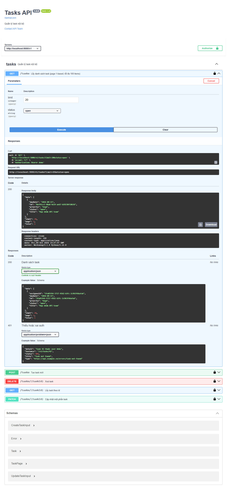
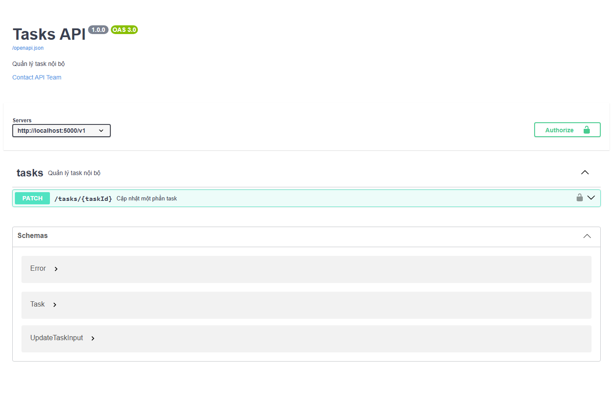
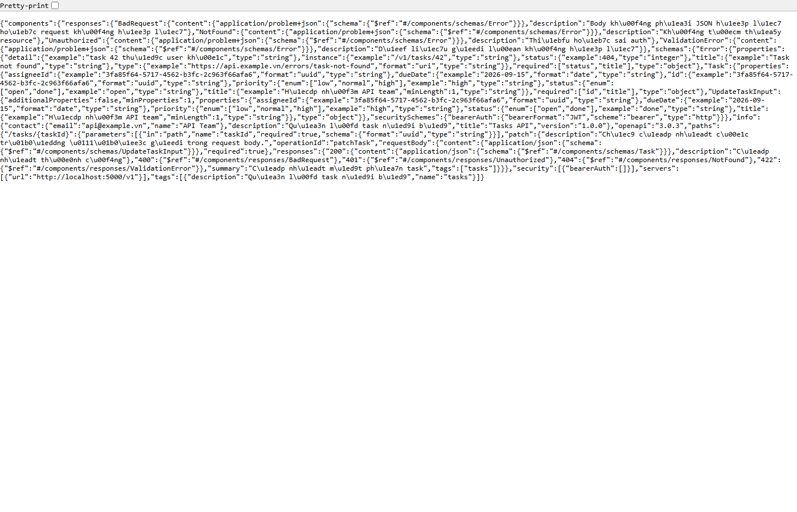
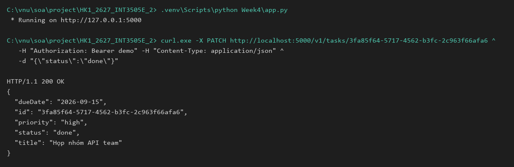

# Week4 — Tasks API: OpenAPI 3.0.3 + Flask + Swagger UI

Bài Buổi 4 (API Specification và OpenAPI): viết spec machine-readable,
sinh docs tự động, implementation validate khớp spec.

## Files

| File | Vai trò |
|---|---|
| `openapi.yaml` | Source of truth: OpenAPI 3.0.3, 1 endpoint `PATCH` |
| `app.py` | Flask implement `PATCH` + `GET /openapi.json` + `GET /docs` |
| `README.md` | File này |

Spec → Doc → Implementation: `openapi.yaml` (sửa 1 nơi) → `/openapi.json`
sinh từ file đó lúc runtime → Swagger UI ở `/docs` render từ `/openapi.json`.

## Cách chạy

```powershell
.venv\Scripts\python -m pip install -r requirements.txt
.venv\Scripts\python Week4\app.py
```

Mở http://localhost:5000/docs → nút **Authorize** → nhập `demo`
(bất kỳ chuỗi nào sau `Bearer ` đều được, xem quyết định 2) →
mở endpoint → **Try it out** → **Execute**.

| Endpoint | Kết quả đúng spec |
|---|---|
| `PATCH /v1/tasks/{id}` | 200 `Task`; body rỗng / field lạ / sai enum → 422; body không phải JSON → 400; sai id → 404; thiếu token → 401 |

## 2 quyết định thiết kế khó nhất

**1. PATCH thay vì PUT — cập nhật một phần, merge từng field.**
Chỉ giữ một operation `PATCH /v1/tasks/{taskId}` (bài tập chỉ yêu cầu sửa task).
Schema `UpdateTaskInput` khai báo `minProperties: 1` và `additionalProperties: false`
nên app trả 422 khi body rỗng hoặc chứa field không được hỗ trợ (implement trong
`check_task_fields` — `Week4/app.py`); server merge bằng `task.update(...)` nên các
field không gửi lên giữ nguyên giá trị. Chọn PATCH thay vì PUT vì PUT là thay thế
toàn bộ, còn yêu cầu là chỉnh sửa một phần.
*(comment trong spec: `UpdateTaskInput`)*

**2. Auth demo: check sự hiện diện của `Bearer`, không verify JWT thật.**
Spec khai báo `security: bearerAuth` toàn cục nên app phải trả 401 khi thiếu token
(implement trong `require_auth()` — `Week4/app.py`; riêng `/openapi.json` và `/docs`
bỏ qua auth để Swagger UI hoạt động được), nhưng không verify chữ ký để
Try it out chạy được mà không cần IdP. Đánh đổi trung thực: đây là placeholder,
production thay bằng `flask-jwt-extended` hoặc OIDC theo slide Security.
*(comment trong code: `require_auth`)*

## Proof

Test riêng từng phần: Swagger UI render, Try it out, Flask app (`/docs`,
`/openapi.json`) và API bằng curl:





