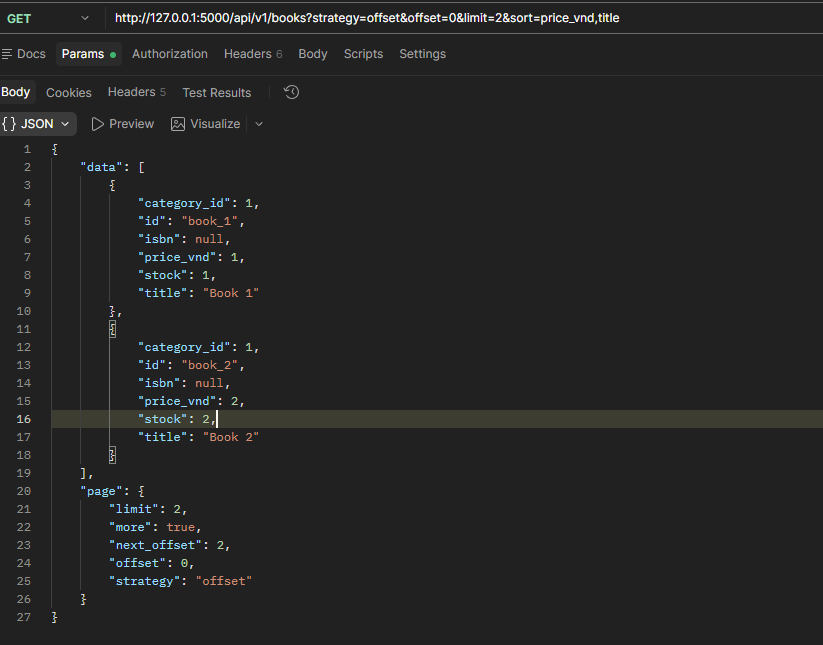
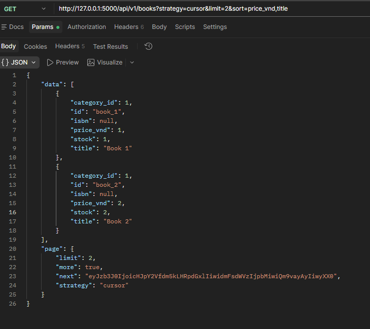
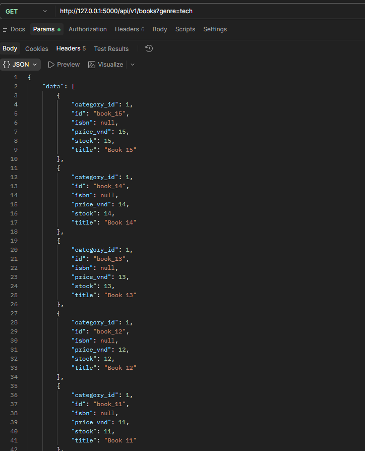
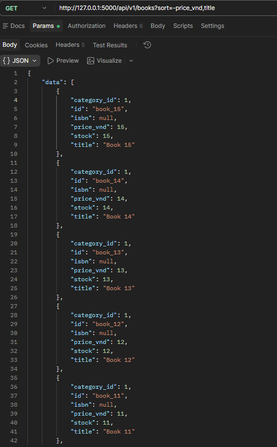
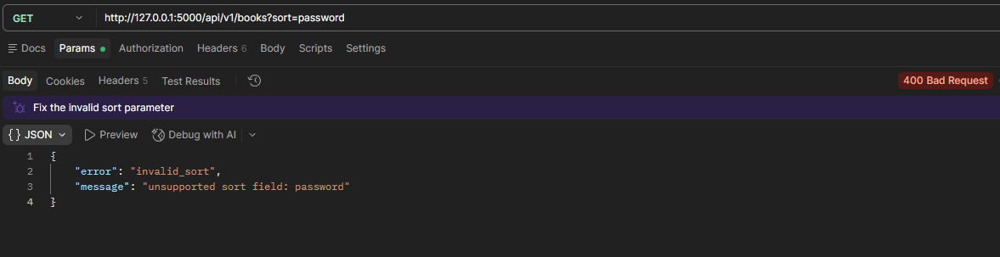
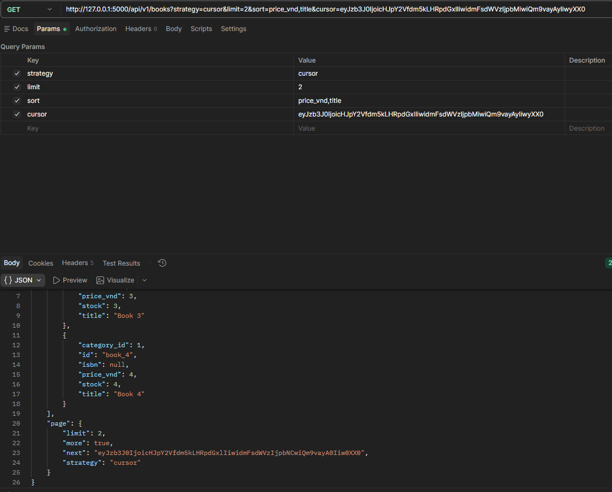

# Bookstore API — Week 5 (Lab 1: List + Pagination)

Flask + Flask-SQLAlchemy API cho tài nguyên `books`, hoàn thiện endpoint **`GET /api/v1/books`** của Lab 1.

## Chạy project

```powershell
# từ thư mục gốc repo
python -m venv .venv
.\.venv\Scripts\Activate.ps1
python -m pip install -r requirements.txt

cd Week5\bookstore-api
python app.py        # http://127.0.0.1:5000
```

## Chạy test

```powershell
cd Week5\bookstore-api
python -m pytest -q
```

## Endpoint

| Method | Path | Mô tả |
|--------|------|-------|
| GET | `/api/v1/books` | Danh sách sách — phân trang, lọc, sắp xếp |
| POST | `/api/v1/books` | Tạo sách (validate theo `schemas/book.json`) |

### Query params của `GET /api/v1/books`

| Param | Kiểu | Mặc định | Ý nghĩa |
|-------|------|----------|---------|
| `strategy` | `cursor` \| `offset` | `cursor` | Chọn kiểu phân trang |
| `limit` | int, `1..100` | `20` | Số bản ghi mỗi trang |
| `sort` | string | `-id` | Sắp xếp multi-key, xem bên dưới |
| `genre` | string | — | Lọc theo `Category.slug` **hoặc** `Category.name` |
| `offset` | int `>= 0` | `0` | Chỉ dùng khi `strategy=offset` |
| `cursor` | string | — | Con trỏ trang kế tiếp, chỉ dùng khi `strategy=cursor` |

### 1. Phân trang offset + cursor (`?strategy=`)

Chọn qua param `?strategy=offset` hoặc `?strategy=cursor` (mặc định `cursor`).

- **offset**: dùng `?offset=N&limit=M`, trả `page.next_offset` khi còn dữ liệu.
- **cursor**: trang đầu không truyền `cursor`; response trả `page.next` (token base64). Trang sau truyền lại `?cursor=<token>`.
  Cursor mã hoá `sort` + giá trị các cột sort, nên **không trùng/không sót** bản ghi khi dữ liệu đổi giữa các trang.
  Cursor sai hoặc không khớp `sort` → `400 invalid_cursor`.

```bash
# offset
curl "http://127.0.0.1:5000/api/v1/books?strategy=offset&offset=0&limit=2&sort=price_vnd,title"

# cursor - trang 1
curl "http://127.0.0.1:5000/api/v1/books?strategy=cursor&limit=2&sort=price_vnd,title"
# cursor - trang 2 (dán token từ page.next của trang 1)
curl "http://127.0.0.1:5000/api/v1/books?strategy=cursor&limit=2&sort=price_vnd,title&cursor=<next>"
```

### 2. Lọc theo thể loại (`?genre=`)

Khớp `Category.slug` hoặc `Category.name`.

```bash
curl "http://127.0.0.1:5000/api/v1/books?genre=tech"
```

### 3. Sắp xếp multi-key (`?sort=`)

Nhiều khoá, phân tách bằng dấu phẩy, thứ tự ưu tiên từ trái sang phải.
Tiền tố `-` = giảm dần. Trường hợp lệ: `id`, `title`, `price_vnd`, `stock`.
Nếu không có `id` trong danh sách, hệ thống **tự thêm `id`** làm khoá tie-break để thứ tự ổn định.

```bash
# giá giảm dần, cùng giá thì theo title tăng dần (multi-key)
curl "http://127.0.0.1:5000/api/v1/books?sort=-price_vnd,title"

# kết hợp cả 3: lọc + sort + phân trang
curl "http://127.0.0.1:5000/api/v1/books?strategy=offset&limit=20&genre=tech&sort=-price_vnd,title"
```

Trường sort không hợp lệ (vd `?sort=password`) → `400 invalid_sort` (không lọt xuống truy vấn DB).

### Response

```json
{
  "data": [
    {"id": "book_3", "title": "Gamma", "isbn": null, "price_vnd": 5, "stock": 3, "category_id": 1}
  ],
  "page": {"strategy": "cursor", "limit": 2, "more": true, "next": "eyJzb3J0Ijoic..."}
}
```

`page` của `strategy=offset` gồm: `strategy`, `offset`, `limit`, `more`, `next_offset`.

### Lỗi (`400`)

`{"error": "<code>", "message": "..."}` với `code` ∈ `invalid_limit`, `invalid_sort`, `invalid_strategy`, `invalid_offset`, `invalid_cursor`.

## Postman

Import [`postman_collection.json`](postman_collection.json) — có sẵn 3 request: offset + genre + multi-sort, cursor trang 1, cursor trang 2.

## Test

`tests/test_books.py` (pytest, DB tạm mỗi test) phủ các thành phần trên:

| Test | Kiểm tra |
|------|----------|
| `test_offset_pagination` | offset + limit + `next_offset` + `more` |
| `test_cursor_pagination_has_no_duplicates` | cursor 2 trang liên tiếp, không trùng |
| `test_cursor_rejects_tampered_cursor` | cursor sai / lệch `sort` → 400 |
| `test_genre_filter` | lọc theo slug và theo tên category |
| `test_multi_key_sort_uses_secondary_key` | khoá phụ (`title`) quyết định khi trùng khoá chính |
| `test_invalid_params_rejected` | sort/strategy/limit/offset không hợp lệ → 400 |

## Hình ảnh chứng minh

Thư mục: [`proof_images/Week5/bookstore_api`](../../proof_images/Week5/bookstore_api)

| # | Ảnh | Nội dung |
|---|-----|----------|
| 1 |  | `strategy=offset` + phân trang |
| 2 |  | `strategy=cursor` trang 1 + `page.next` |
| 3 |  | `strategy=cursor` trang 2 bằng cursor |
| 4 |  | `?genre=tech` |
| 5 |  | `?sort=-price_vnd,title` |
| 6 |  | `?sort=password` → 400 |

Bổ sung: Postman collection (`postman_collection.json`) và test (`pytest`, `6 passed`) là thành phần bắt buộc nhưng chưa có ảnh chụp.
