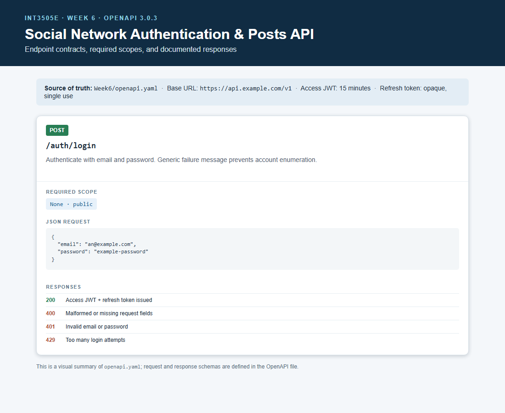
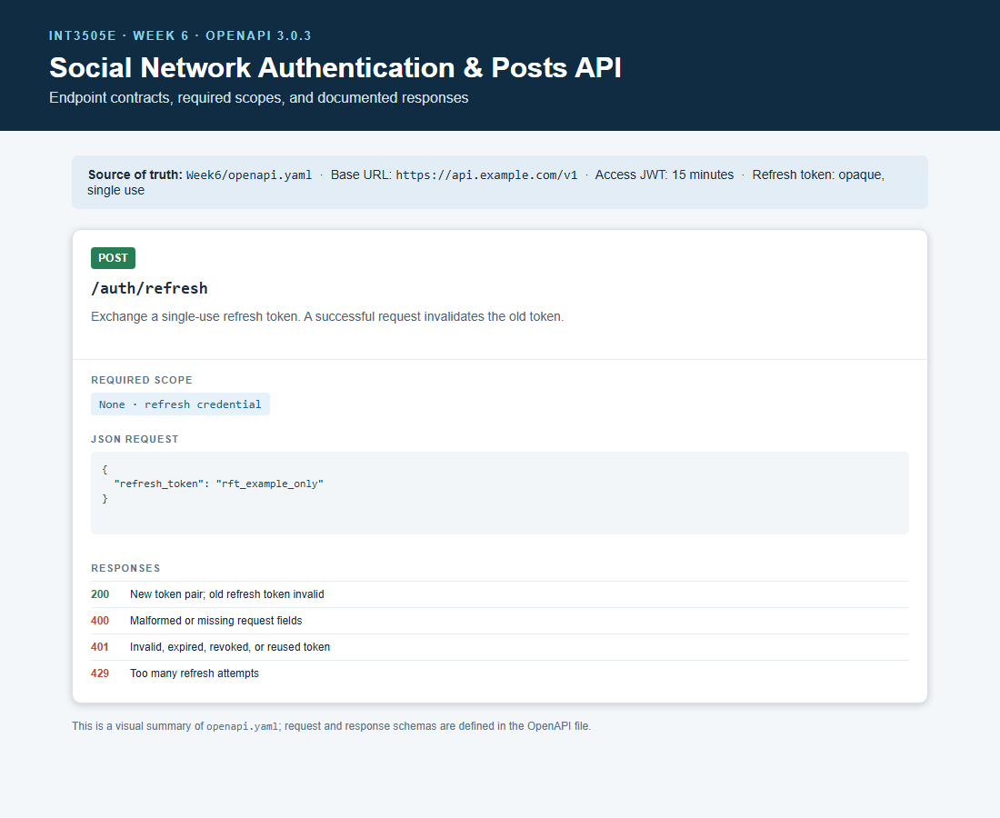
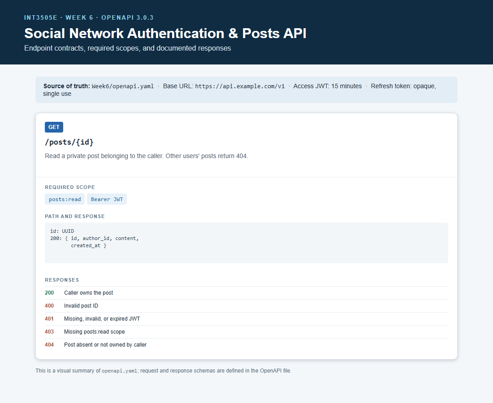

# Tuần 6 — Authentication và Authorization

## Các tệp

- [openapi.yaml](openapi.yaml): đặc tả OpenAPI 3.0.3, gồm request/response schema và cơ chế xác thực.
- [SecurityAudit.md](SecurityAudit.md): 5 rủi ro bảo mật và biện pháp xử lý bằng tiếng Việt.
- [spec-preview.html](spec-preview.html): trang xem nhanh dùng để chụp ảnh từng endpoint. Nội dung đầy đủ và có giá trị tham chiếu nằm trong `openapi.yaml`.

## Tóm tắt hợp đồng

| Endpoint | Xác thực và scope | Thành công | Lỗi được mô tả |
|---|---|---|---|
| `POST /auth/login` | Công khai; không cần scope | 200 | 400, 401, 429 |
| `POST /auth/refresh` | Cần refresh token trong JSON body; không cần access JWT hoặc scope | 200 | 400, 401, 429 |
| `GET /posts/{id}` | Bearer access JWT, scope `posts:read`, và quyền sở hữu bài viết | 200 | 400, 401, 403, 404 |

Access JWT có thời hạn 15 phút. Refresh token là chuỗi opaque, chỉ dùng một lần và được thay mới khi gọi `/auth/refresh`. Bài viết của người khác trả 404 để không tiết lộ sự tồn tại của tài nguyên. Scope được ghi bằng `x-required-scopes` vì cơ chế đăng nhập này tự cấp Bearer JWT, không khai báo một luồng OAuth 2.0.

## Ảnh minh chứng từng endpoint

### `POST /auth/login`

### `POST /auth/refresh`

### `GET /posts/{id}`

Ảnh tổng quan: [openapi_spec.png](../proof_images/Week6/openapi_spec.png).

Đây là bài nộp **đặc tả API**; chưa có backend chạy thật cho ba endpoint này.
