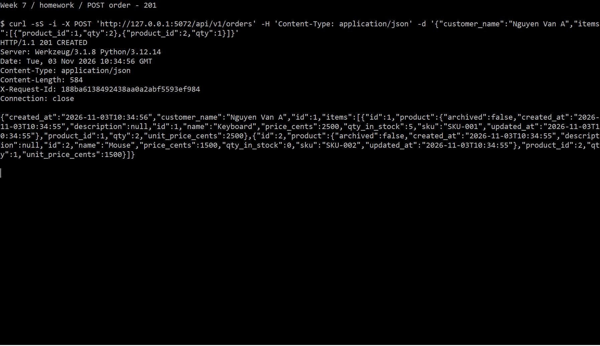
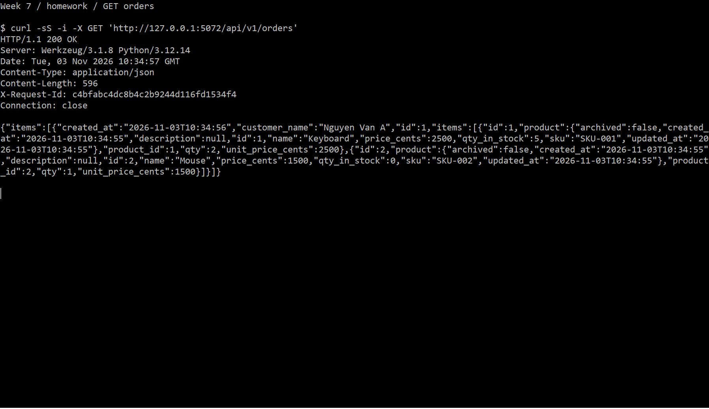
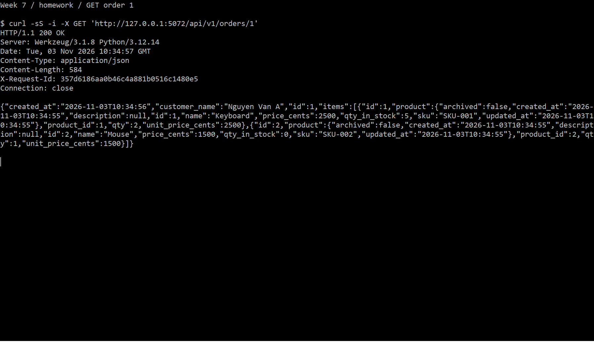
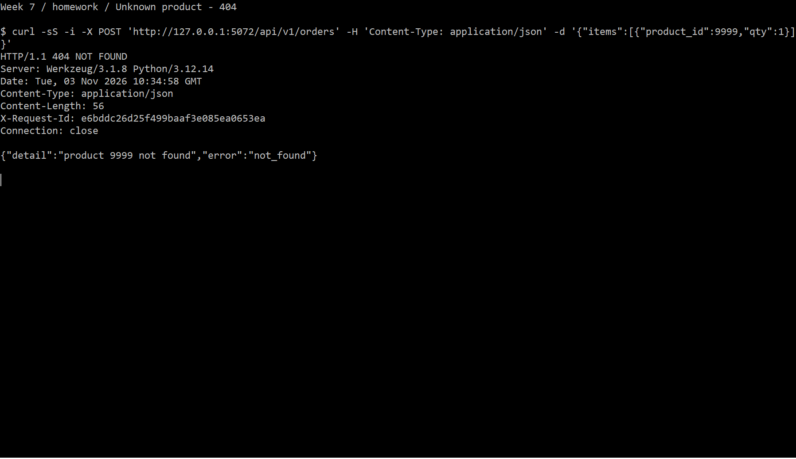
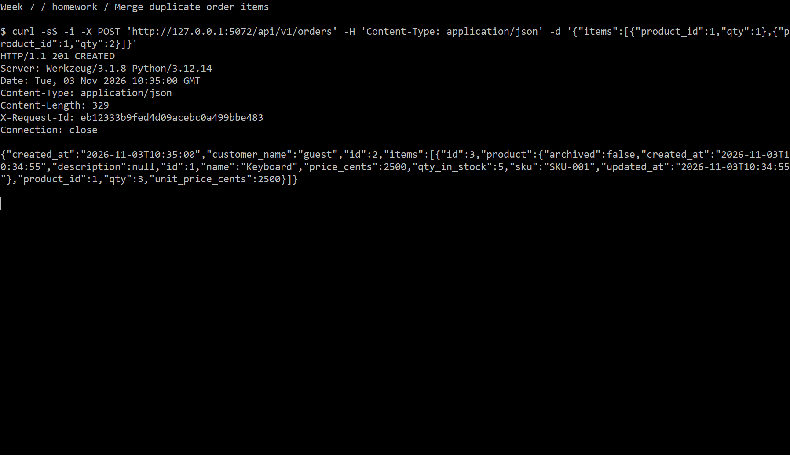
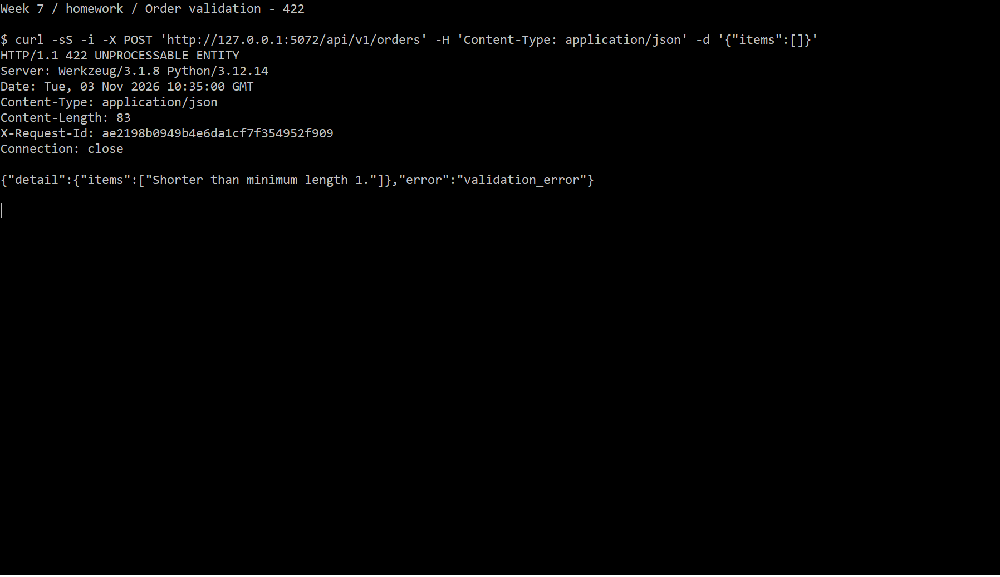
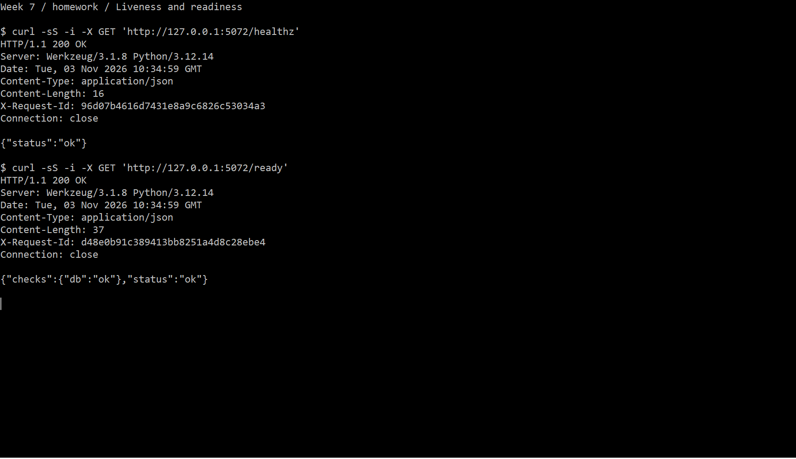
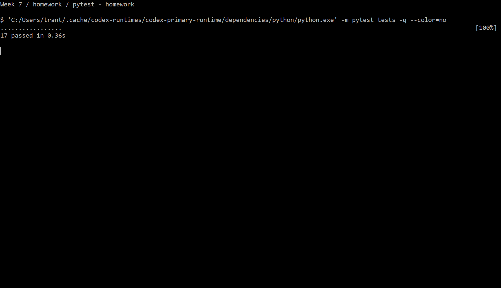

# Week 7 — Homework: Orders và Health Check

## 1. Tạo đơn hàng

## 2. Danh sách đơn hàng

## 3. Chi tiết đơn hàng

## 4. Sản phẩm không tồn tại

## 5. Gộp các dòng trùng sản phẩm

## 6. Kiểm tra dữ liệu đơn hàng

## 7. Liveness và readiness

## 8. Kiểm thử tự động

