# Week 7 — Lab1: Product API

## 1. Danh sách sản phẩm và phân trang

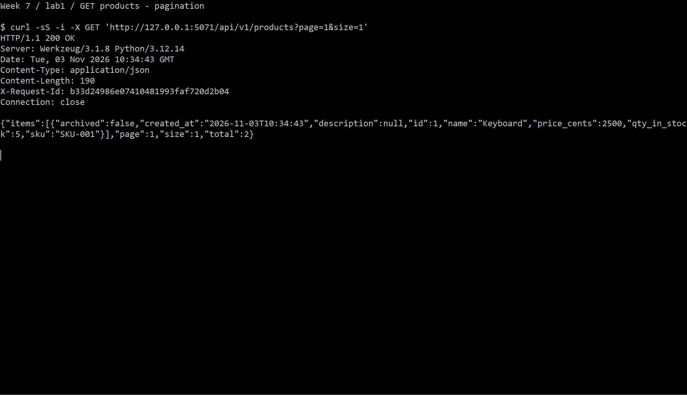

## 2. Chi tiết sản phẩm

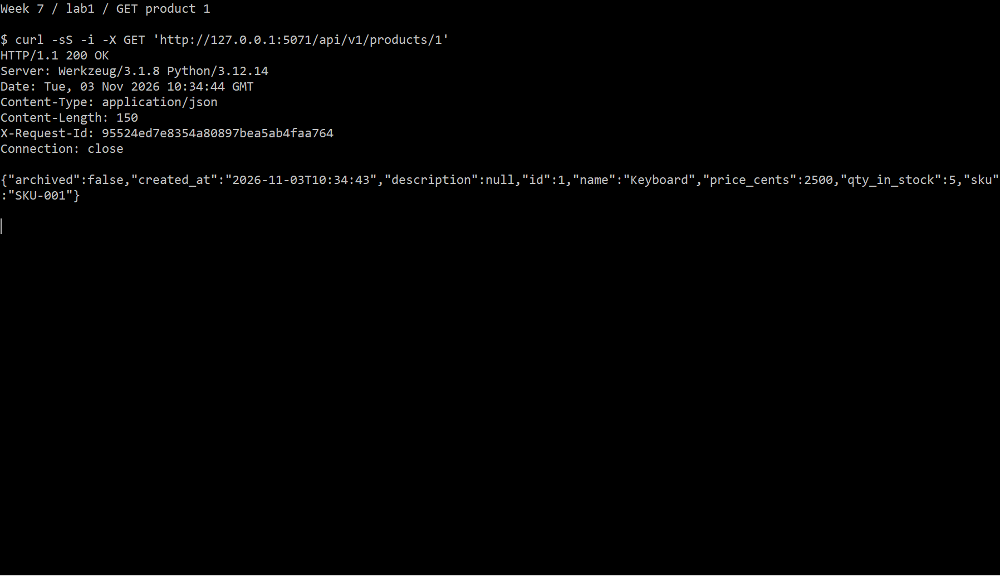

## 3. Tạo sản phẩm

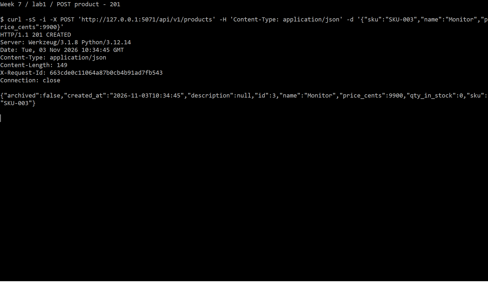

## 4. Từ chối SKU trùng

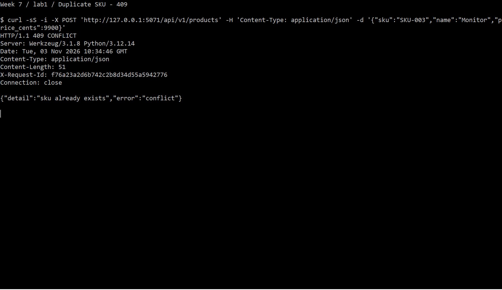

## 5. Cập nhật một phần

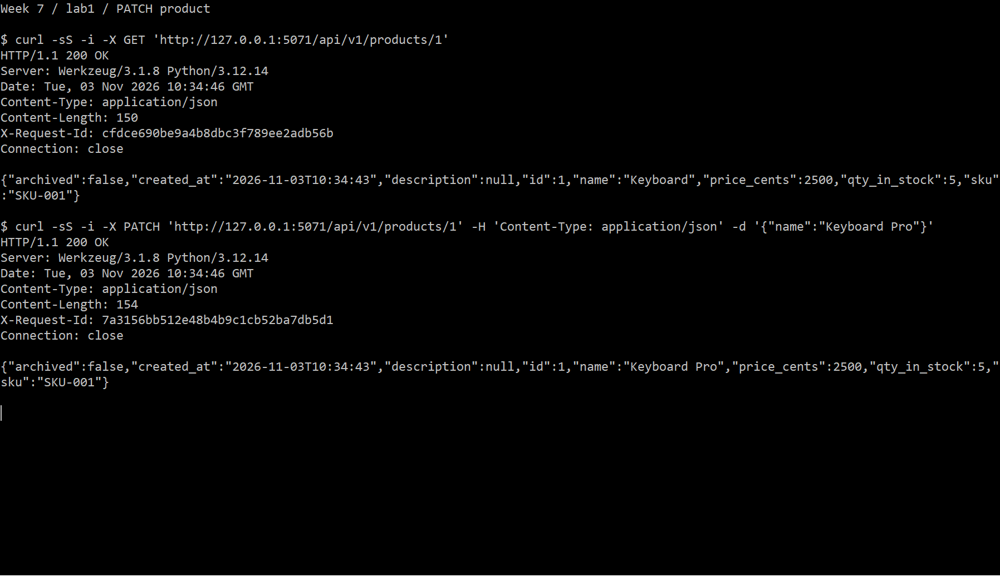

## 6. Giữ hàng và giảm tồn kho

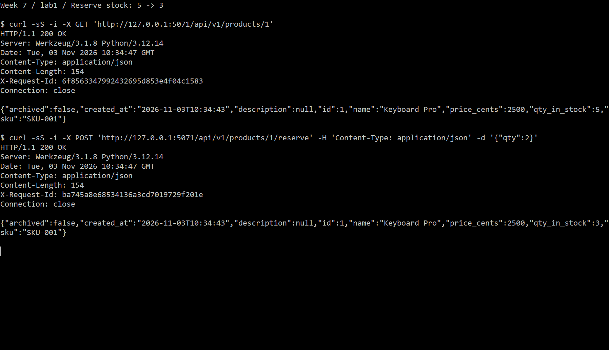

## 7. Từ chối khi không đủ hàng

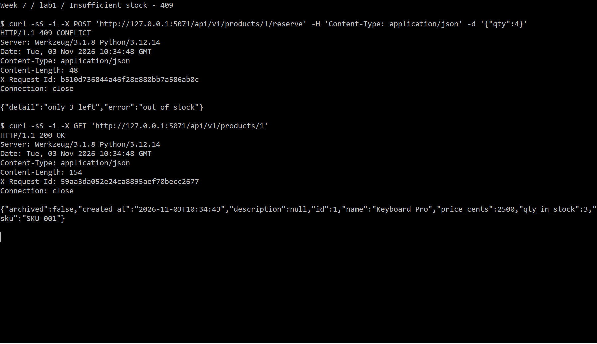

## 8. Xóa mềm

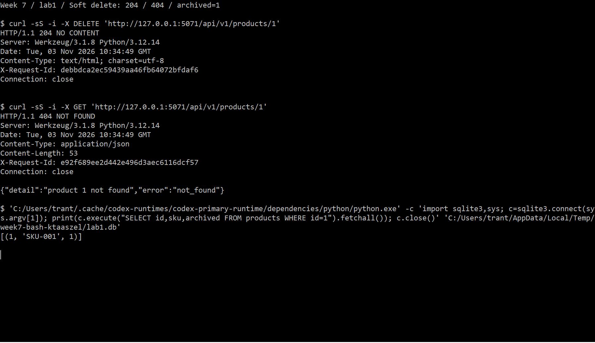

## 9. Kiểm tra dữ liệu đầu vào

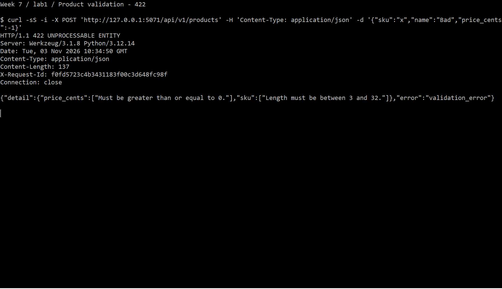

## 10. Kiểm thử tự động

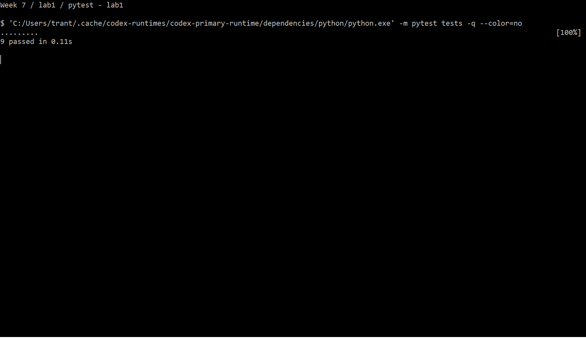

## 11. Migration cơ sở dữ liệu

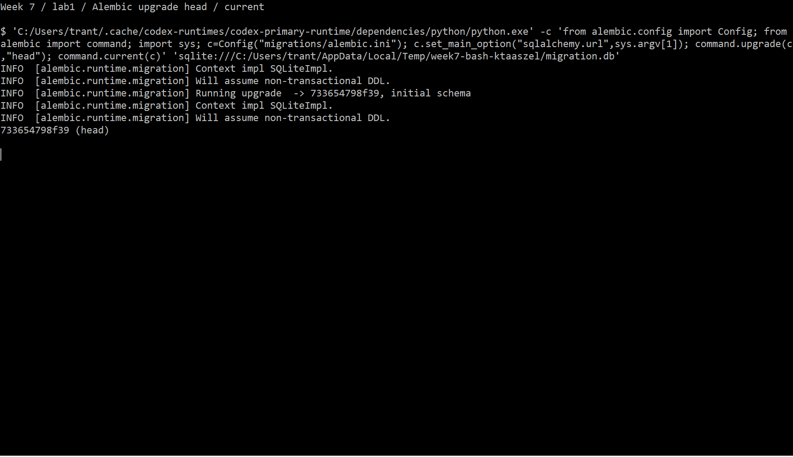
